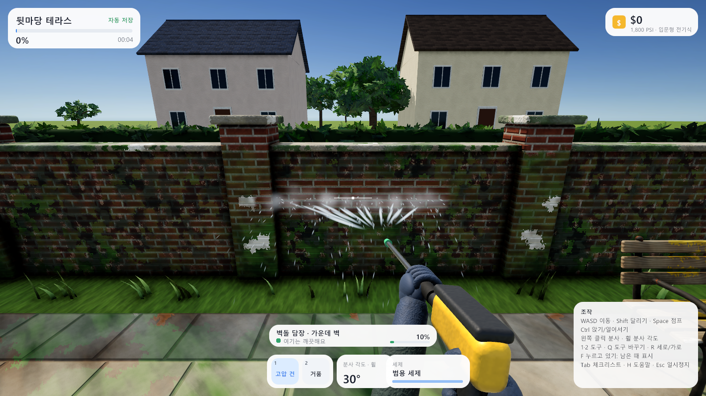

# 반짝 워시 (Banjjak Wash)

혼자 하는 고압세척 시뮬레이션 게임이에요. 고압 건과 세제 거품으로 마당, 캠핑카, 놀이터, 주택, 스케이트 공원, 분수 광장, 주유소, 3층 상가 건물까지 8개 현장을 깨끗하게 닦아요.

**▶ 바로 플레이: GitHub Pages 링크** (이 저장소의 Settings → Pages에 표시돼요)

PC의 크롬이나 엣지에서 키보드와 마우스로 플레이해요. 처음 열 때 수십 MB를 받아서 몇 초 걸려요. 진행 상황은 브라우저에 저장돼요.

## 조작

| 키 | 동작 |
|---|---|
| WASD · Shift · Space | 이동 · 달리기 · 점프 |
| Ctrl | 앉기 / 일어서기 |
| 왼쪽 클릭 | 분사 |
| 마우스 휠 | 분사 각도 0°~45° (터보 노즐이 있으면 0° 아래로 내려 터보) |
| 1 · 2 · 3 | 고압 건 · 거품 분사기 · 원형 바닥 세척기 |
| 4 | 자동 잔디 깎기 출발 / 회수 |
| Q | 세제 바꾸기 |
| R | 분사 방향 가로 / 세로 |
| E | 쓰레기 줍기 · 잡초 뽑기 · 쓰레기통에 버리기 |
| G | 청소 로봇 출동 / 회수 |
| L | 고소 작업대 설치 / 회수 (작업대 위 Space 올리기, C 내리기) |
| F | 남은 때 표시 켜기 / 끄기 |
| Tab | 남은 곳 목록 |
| Esc | 일시정지 · 의뢰 목록 · 장비 가게 |

## 게임 방식

- 진행도와 의뢰 완료는 **때를 닦은 양**으로만 정해져요. 잡초, 쓰레기, 잔디는 부수입이에요.
- 16가지 때(먼지, 진흙, 이끼, 곰팡이, 녹, 물때, 껌, 낙서 등)마다 지워지는 속도가 달라요.
- 세제 거품을 뿌리고 잠시 불린 뒤 물로 헹구면 훨씬 빨리 지워져요. 때에 맞는 세제일수록 효과가 커요.
- 장비 가게에서 더 센 고압세척기, 터보 노즐, 연장 랜스, 로봇(바닥 세척, 쓰레기 줍기, 벽·유리창 드론, 잔디 깎기)을 살 수 있어요.

## 직접 빌드하기

- Unity 6.3 LTS (6000.3.29f1), URP
- 에디터 메뉴 `반짝 워시` → `Windows 빌드` 또는 `웹(WebGL) 빌드`
- 처음 열 때는 `반짝 워시` → `프로젝트 설정 다시 적용`, `텍스처 다시 굽기`를 한 번 실행해 주세요.
- 모든 모델과 텍스처는 코드로 만들어요 (`Assets/Scripts/Build`).

## 크레딧

- 글꼴: 나눔고딕 (NAVER, SIL Open Font License 1.1) — `Assets/Resources/Fonts/NanumGothic-OFL.txt`
- PowerWash Simulator 같은 세척 게임에서 영감을 받은 개인 팬 프로젝트이며, 해당 게임과는 관계가 없어요.
